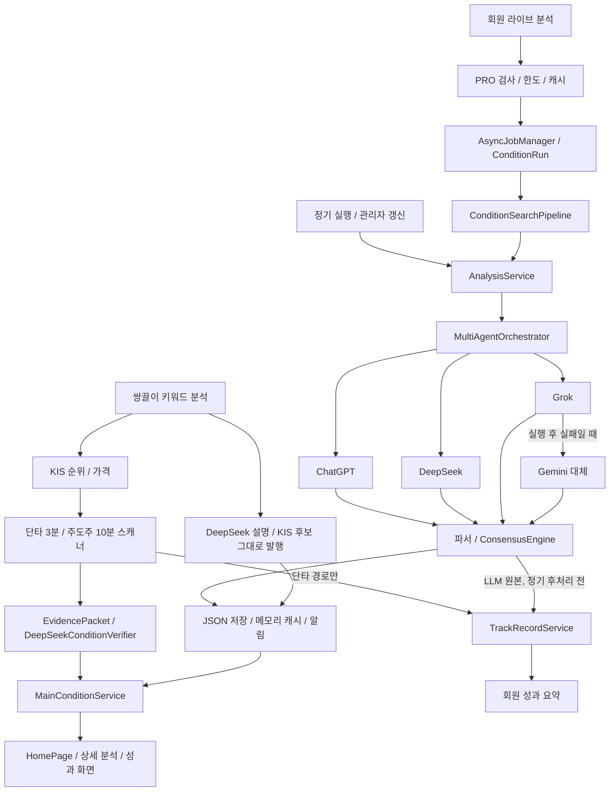

# BitMan 에이전트 파이프라인 점검 — 2026-10-11

최신 운영 저장 결과의 4개 모드는 모두 에이전트 **2/2 성공**, 합의 결과 포함 상태다. 그러나 가격·성과·후보 검증 경계에서 우선 수정할 결함 3건을 재현했다. 기존 백엔드 테스트 **289개 통과**는 이 경계의 정확성을 보장하지 않는다.

이번 요청의 범위는 **팀 구성과 전체 경로 점검**이다. 아래 결함은 아직 수정하지 않았다. 앱 코드, 운영 데이터, 회원 상태, 운영 배포는 변경하지 않았으며, 점검 문서와 오프라인 재현 코드만 추가했다.

## 기준과 팀

- 소스 기준: `5b678ca8abc0d8f695d1230ded60eef07660d929`, `main`.
- 총괄: 경로 연결, 합의, 저장, 작업 접근 권한, 전체 검증 및 결과 판정.
- AI 제공자 담당: OpenAI / DeepSeek / Grok / Gemini 응답 처리, 구조화 파서, 조건 검증기.
- 데이터 담당: KIS / DART 연결, 스캐너, 점수, 가격 계약, 성과 추적.
- 운영 담당: 스케줄, 실패 복구, 작업 상태, 알림, 화면 갱신, 레거시 실행 경로.
- `재현`: 실제 소스 또는 컴파일된 현재 클래스를 격리된 가짜 제공자·저장소·시계 입력으로 실행했다. 실제 외부 AI/KIS 요청과 실제 회원 DB는 사용하지 않았다.
- `소스`: 호출 경로에서 확인했지만 실제 운영 실패는 발생시키지 않았다.
- `설계/미확인`: 기능 부재 또는 가능성을 확인한 수준이며, 운영에서 발생했다는 뜻이 아니다.

이 문서의 Java 경로는 `backend/src/main/java/com/bitman/justbuy/` 기준이다. 줄 번호는 위 소스 기준이다. 기존 작업 중이던 21개 경로는 이번 변경에 포함하지 않는다.

## 현재 운영 증거

2026-10-11 **21:03 KST**, MiniPC의 4개 분석 JSON에서 모드·시각·픽 개수·에이전트 상태·합의 존재 여부만 읽었다. 원문 분석, 원문 오류, 키, 회원 DB는 읽지 않았다.

| 모드 | 저장 시각 KST | 픽 | 성공/사용 | 합의 참여 수 |
|---|---|---:|---:|---:|
| BREAKOUT | 20:46:28 | 5 | 2/2 | 2 |
| FLOW_LEADER | 20:48:25 | 5 | 2/2 | 2 |
| REVERSAL_EDGE | 20:47:26 | 3 | 2/2 | 2 |
| CATALYST_BURST | 20:49:24 | 3 | 2/2 | 2 |

- ChatGPT: `gpt-5.5-2026-04-23`, 성공, 각 모드 약 53–59초.
- DeepSeek: `deepseek-flash`, 성공, 각 모드 약 18–21초.
- Grok: 설정 부재로 `skipped`. Gemini는 설정상 사용 가능하지만 이 실행의 대체 경로에서 호출되지 않았다.
- 공개 `/api/health`: `ok`, 사용 가능 설정 3/4. 이 값은 키/설정 존재 여부이며, 제공자 인증을 새로 성공시켰다는 증거는 아니다.
- JSON의 저장된 `isFresh=true`는 현재 서비스가 그 결과를 신선하다고 판정한다는 증거와 구분해야 한다.

사용자가 보고했던 **CATALYST_BURST 1/2 성공 경고는 이 최신 4개 저장 결과에서는 재발하지 않았다.** 기존 오류가 영구적으로 해결됐다는 결론은 내리지 않는다.

## 실제 실행 경로



정기 4개 모드는 LLM 중심이고, 장중 스캐너와 키워드 분석은 규칙으로 만든 후보에 AI 설명/검증을 더한다. `ConditionSearchPipeline`이라는 이름만으로 모든 경로가 동일한 후보·증거 검증을 수행한다고 볼 수 없다. Round 2 통합은 현재 비활성이고 최종 본문은 ChatGPT 우선, 다음 성공 에이전트 순으로 선택한다.

| 경로 | 실제 상태 | 점검 범위 |
|---|---|---|
| 정기 BREAKOUT/FLOW_LEADER/REVERSAL_EDGE/CATALYST_BURST | 활성, 평일 08:50/11:50/14:50, 거래일 검사 | 호출/응답/합의/저장/실패/운영 캐시 확인 |
| 시작 시 누락·무효 캐시 보충 | 활성, 시작 후 약 30초 | 거래일·시간 제한이 정기 실행과 다름을 확인 |
| 회원 일반·개별종목 라이브 분석 | 활성, 비동기 작업 및 폴링 | 한도/캐시/상태/작업 소유권 점검 |
| 쌍끌이 키워드 분석 | 활성, 별도 서비스 | KIS 후보 데이터와 DeepSeek 설명 경로 점검; 조건 검증기와 별도 |
| 단타·주도주 장중 스캐너 | 활성, 각각 3분/10분 | 후보/점수/검증/포착 가격/성과 경계 재현 |
| 직접 DeepSeek 3개 API | 활성, PRO 제한 | 한도와 입력 크기 검사가 일반 라이브 경로와 다른 점 확인 |
| 단타·일반·종가 성과 추적 | 활성 | 가격 단위, 마감 판정, 기간별 가격 기록 점검 |
| KIS/DART/재무 보강 | 일부 경로 활성 | 실패 시 처리와 실제 호출자를 확인; 외부 요청은 수행하지 않음 |
| DartDisclosureSearchService | 현재 주 실행 호출자 없음 | 존재하는 서비스와 활성 경로를 구분 |
| SynthesisEngine / OpenAiCompatibleAgent | 주 실행 경로에서 비활성 | 현재 활성 결함으로 집계하지 않음 |
| App.tsx / AnalysisOverlay / ConsensusDisplay | 실제 main.tsx 진입 경로에서 비활성 | 현재 화면 검증 대상으로 혼동하지 않음 |
| Flask / Python scheduler | 잔존·조건부 레거시 | 정적 경로 점검; 운영 데몬 실행 여부 미확인 |

실제 프론트엔드는 Vite/React이며 `frontend/src/main.tsx:61`에서 HomePage로 진입한다. 저장소의 과거 Next.js/`engine/` 중심 설명은 현 구조와 일치하지 않는다. 현재 Java의 Flask 연동은 시장 게이트 경로 등이 남아 있으며, 과거 US/Crypto Java 대시보드 경로를 현 주 실행으로 간주하지 않았다.

## P1 — 데이터 신뢰성 우선 수정

| ID | 결함과 영향 | 증거 / 위치 |
|---|---|---|
| P1-01 | 단타 스캐너가 `highPrice`에 등락률 `+5.21%`를 넣는다. 성과 추적기는 숫자를 추출해 목표가 **521원**으로 저장한다. 진입 10,000원 → 종가 9,700원, 수익률 **-3%**인데도 `hitTarget=true`가 된다. 회원 목표 도달률도 영향을 받는다. | **재현** `RuntimeDataProbe`; `service/ShortTermRealtimeScanner.java:509`, `service/TrackRecordService.java:126`, `:309`, `:472`, `service/MemberTrackRecordService.java:138` |
| P1-02 | 홈 성과 요약이 완료된 실제 수익 대신 현재 후보의 `maxReturnPct`를 집계한다. 목표가가 없으면 +6% 같은 기본 예상치를 만들고, 실제 성과가 없어도 **검증 신호 1건 / 평균 +6% / 승률 100%**로 표시한다. | **백엔드+UI 재현** `RuntimeDataProbe`, `ui-audit-probe`; `service/MainConditionService.java:104`, `:618`, `:721`, `:848`; `frontend/src/pages/HomePage.tsx:367` |
| P1-03 | 정기·라이브가 공유하는 LLM 핵심 단계의 후보 제한은 프롬프트에 의존한다. 파싱 후 코드가 입력 후보에 포함됐는지, 유효한 현재가가 있는지 강제하지 않는다. 입력 후보는 005930뿐인데 가짜 응답의 **999999 / 10,000원**이 검증 가격 없이 픽에 남고 `isFresh=true`, 에이전트 2/2 성공이 된다. | **핵심 단계 재현** `PipelineAuditProbe`; `ai/MultiAgentOrchestrator.java:335`, `:484`, `:518`, `:622`, `:681`. 정기 최종 후처리까지 재현한 것은 아니다. |

수정 기준: 금액과 퍼센트를 별도 타입/필드로 구분하고, 실측 성과가 없는 상태를 0건/미집계로 표시한다. 정기 분석도 출처가 있는 후보 집합과 시세 검증을 통과한 종목만 결과로 내보내야 한다. 검증 불가 시 픽 제거 또는 명확한 비검증 상태가 필요하다.

P1-03의 정기 실행에는 추가 Naver 종목 존재/이름·ETF·모드 간 중복 후처리가 있다(`service/PrecomputeScheduler.java:203`). Naver가 미존재로 답하면 해당 코드를 제거하지만, 조회 예외에는 원래 픽을 유지한다(`:231`, `:250`). 이 후처리는 입력 후보 소속이나 가격을 보증하지 않으며, 회원 라이브는 같은 정기 후처리를 거치지 않는다. fixture의 999999가 정기 최종 피드에 실제 발행됐다고 주장하지 않는다.

## P2 — AI 응답·합의·근거

| ID | 발견 사항 | 증거 / 위치 |
|---|---|---|
| P2-01 | 동일 에이전트의 동일 종목 중복이 별도 표로 계산된다. 2개 에이전트 중 1개만 추천해도 중복 두 번이면 합의 점수 **50→100**, 실제 투표자는 1명이다. | **재현** `PipelineAuditProbe`; `ai/ConsensusEngine.java:55`, `:63`, `:81`, `:95` |
| P2-02 | Grok `incomplete`/빈 객체, Gemini `MAX_TOKENS`/본문 없는 SAFETY+출처 응답을 성공 처리한다. Grok의 빈 성공은 Gemini 대체도 막는다. DeepSeek는 명시적 `length`는 거부하지만 `finish_reason` 누락은 성공 처리한다. | **재현** `AuditProbe`; `ai/agent/GrokAgent.java:172`, `ai/agent/GeminiAgent.java:131`, `ai/agent/DeepSeekAgent.java:95`; 대체 분기 `ai/MultiAgentOrchestrator.java:397` |
| P2-03 | 조건 검증기는 `VALID`와 `aiScore=99`만 있어도 근거·위험·무효화 조건 없이 받는다. 미정의 verdict도 거부되지 않고, 동일 코드의 REJECT 뒤 VALID가 오면 마지막 값으로 덮인다. 스캐너의 최종 점수에는 AI 점수가 섞인다. | **재현** `AuditProbe`; `service/DeepSeekConditionVerifier.java:138`, `service/LeaderConditionEngine.java:212`, `service/ShortTermRealtimeScanner.java:272` |
| P2-04 | Grok 응답에서 첫 output_text만 취해 두 번째 구조화 JSON을 잃는다. 공식 문자열 citation 배열/annotation도 현재 파서에서 유실된다. | **재현** `AuditProbe`; `ai/agent/GrokAgent.java:185`, `:202` |
| P2-05 | 구조화 파서가 `ABCDEF` 코드, `NaN` 신뢰도, 합계 0인 시나리오 확률, 빈 이유를 수용한다. 합의 API의 숫자 품질을 해친다. | **재현** `AuditProbe`; `util/StructuredAnalysisParser.java:119`, `:122`. 별도 StockPick 텍스트 파서는 숫자 6자리만 받으므로 이 fixture가 그대로 홈 픽에 나간다고 주장하지 않는다. |
| P2-06 | DeepSeek 잘림 오류는 이미 사용한 50토큰을 0으로 기록한다. Gemini는 thoughtsTokenCount/modelVersion을 보존하지 않아 총 90토큰 응답을 50토큰으로 기록한다. 비용·모델 추적에 필요한 증거가 줄어든다. | **재현** `AuditProbe`; `ai/agent/DeepSeekAgent.java:95`, `dto/AgentResult.java:17`, `ai/agent/GeminiAgent.java:170` |

검증기가 후보 밖 코드 999999를 내부 Map에 보존하는 것도 재현했다. 다만 현재 스캐너 호출자는 입력 후보별 코드로 조회하므로 **이 현상만으로 새 종목이 발행된다고 집계하지 않았다**. 정기 분석의 P1-03은 별도 경로다.

## P2 — 가격·후보·성과 계약

| ID | 발견 사항 | 증거 / 위치 |
|---|---|---|
| P2-07 | 스캐너는 첫 포착 시각을 유지하면서 포착 가격을 매번 현재가로 교체한다. 10:00/10,000원이 10:03에 **10:00/12,000원**으로 바뀐다. 시각과 가격이 서로 다른 스냅샷을 가리킨다. | **재현** `RuntimeDataProbe`; `service/ShortTermRealtimeScanner.java:212`, `:507`; 주도주도 `service/LeaderConditionEngine.java:166`, `:255`에 동일 구조 |
| P2-08 | 1/3/5일 추적은 달력 경과일을 사용하고 누락된 기간을 현재 시세 한 값으로 채운다. 5일 전 신호에 현재 11,000원을 넣으면 **1d=3d=5d=11,000, COMPLETED**가 된다. 거래일·각 시점의 가격을 기록한 성과가 아니다. | **재현** `RuntimeDataProbe`; `service/TrackRecordService.java:189`, `:203`, `:465` |
| P2-09 | 상승률 순위가 별도 순위 API 대신 거래량 순위 풀을 재정렬한다. 단타의 두 순위 교집합 보너스가 독립된 신호의 중복 확인을 뜻하지 않는다. | **소스** `service/KisApiService.java:862`, `:1071`; `service/ConditionSignalScoring.java:33`. 실제 KIS 순위 차이는 이번에 조회하지 않았다. |
| P2-10 | 주도주 후보를 충분히 수집·정렬하기 전에 limit에서 멈춘다. 응답 뒤쪽의 더 강한 수급 후보를 놓칠 수 있다. | **소스** `service/KisApiService.java:981`, `:1017`; 실제 운영 후보 누락은 미검증 |

## P2 — 상태·접근·저장·알림

| ID | 발견 사항 | 증거 / 위치 |
|---|---|---|
| P2-11 | 에이전트 **0/2, 픽 0**인 실패 응답을 `ConditionRun COMPLETE`로 기록할 수 있다. 예외가 없으면 정기 갱신 성공/최근 실행 시각도 갱신된다. 실패 결과의 캐시 저장을 막는 것과 실행 성공을 판정하는 것은 별개다. | **상태 재현+정기 경로 소스** `PipelineAuditProbe`; `condition/run/ConditionRunService.java:70`, `service/AnalysisService.java:185`, `service/PrecomputeScheduler.java:391`, `:410`, `:438`, `:486` |
| P2-12 | 분석 JSON 저장 IOException을 로그만 남기고 삼킨다. 영속 결과가 없어도 성공 응답과 메모리 라이브 캐시가 남는다. 재시작 뒤 보존할 결과가 없다. 직접 덮어쓰기도 원자적이지 않다. | **저장 실패 재현** `PipelineAuditProbe`; `service/AnalysisService.java:189`, `:200`. 쓰기 중단/파일 파손은 별도 미재현 위험이다. |
| P2-13 | 비동기 작업에 소유 회원 ID가 없다. 다른 PRO 회원도 알려진 jobId로 결과를 가져올 수 있다. 격리된 다른 principal에서 **HTTP 200**을 재현했다. | **재현** `PipelineAuditProbe`; `service/AsyncJobManager.java:24`, `:35`; `controller/AnalysisController.java:155`, `:182`. 실제 회원 결과를 조회하지 않았다. |
| P2-14 | `/api/monitor/health`의 서버 캐시가 공통 Caffeine 설정을 받아 **4시간** 유지된다. 브라우저 Cache-Control 변경만으로 서버 상태 갱신 지연은 해결되지 않는다. 공개 `/api/health`는 이 캐시 경로와 다르다. | **실제 캐시 bean 재현** `PipelineAuditProbe`; `controller/MonitorController.java:34`, `:111`, `config/AppConfig.java:46` |
| P2-15 | Telegram 전송은 실패/미설정이어도 void로 끝날 수 있는데 호출자는 무조건 NOTIFIED 이벤트를 남긴다. 실패 전송의 확인·재시도 근거가 없다. | **소스** `service/TelegramNotifier.java:65`, `:103`, `:135`, `:156`; `service/PrecomputeScheduler.java:118`, `:425`. 실제 메시지는 보내지 않았다. |
| P2-16 | 관리자 전체 갱신은 긴 동기 HTTP 요청에서 4개 모드를 순차 실행한다. 프론트엔드에는 jobId 폴링 분기가 있지만 이 API의 백엔드 계약은 작업 ID를 반환하지 않는다. 요청 연결이 끝나면 진행·결과를 이어 확인하기 어렵다. | **소스** `controller/AdminController.java:298`, `:310`; `frontend/src/api/authApi.ts:324`. 실제 프록시 시간초과는 발생시키지 않았다. |
| P2-17 | 직접 DeepSeek 구조화/검증/위험 API는 PRO만 확인하고 일반 라이브의 사용 한도·입력 크기 제한을 거치지 않는다. 반복 유료 호출을 제한하는 정책이 일관되지 않다. | **소스** `controller/DeepSeekAnalysisController.java:33–51`; 실제 유료 POST는 수행하지 않았다. |

## P2 — 실제 홈 화면 데이터 흐름

| ID | 발견 사항 | 증거 / 위치 |
|---|---|---|
| P2-18 | 직접 갱신한 endpointRows를 이후 자동 갱신 결과보다 계속 우선한다. 09:00 종목이 남은 채 12:00 시각을 표시하고 새 종목은 숨겨진다. | **실제 TS/SSR 재현** `ui-audit-probe`; `frontend/src/pages/HomePage.tsx:248`, `:320`, `:322` |
| P2-19 | 분석 A를 닫고 B를 실행해 B가 먼저 완료돼도, 늦게 끝난 A가 최종 상태를 덮어쓴다. 요청 세대/취소 검사가 없다. | **실제 hook 재현** `ui-audit-probe`; `frontend/src/hooks/useAnalysis.ts:63`, `:90` |
| P2-20 | 브라우저 분석 캐시 TTL 24시간 동안 신선도를 다시 계산하지 않는다. 2시간 전 라이브 결과가 서버 요청 없이 **isFresh=true / isPrecomputed=false**로 복원된다. | **실제 cache+hook 재현** `ui-audit-probe`; `frontend/src/lib/analysisCache.ts:13`, `frontend/src/hooks/useAnalysis.ts:55`; 화면 라벨 `frontend/src/pages/HomePage.tsx:173` |

이번 UI 증거는 실제 소스를 메모리에서 transpile하고 가짜 브라우저 저장소·네트워크와 React SSR로 실행한 것이다. 운영 브라우저의 실제 버튼 클릭/DOM 검증을 수행했다는 뜻은 아니다.

## 설계 공백과 조건부 경로

| 항목 | 확인한 범위와 제한 |
|---|---|
| 재시작 복구 | ConditionRun/AsyncJob은 메모리만 사용한다. 단계별 영속 상태, 재시작 이어 실행, 실패 단계만 재시도, 취소가 없다. 저장된 성공 JSON은 별도로 보존된다. |
| 전역 시간 예산 | 에이전트별 future 대기가 순차이고 executor 종료 시 잔여 작업을 기다릴 수 있다. 단일 전체 실행 기한과 단계 예산이 없다. 실제 장시간 멈춤은 이번에 발생시키지 않았다. |
| 공급자 오류 분류 | adapter에서 인증 오류·429·timeout을 일반 error로 처리하며 응답/request ID, Retry-After, 인증 격리와 쿨다운 계약이 없다. 실제 운영 401/429 장애를 발생시킨 것은 아니다. |
| 직접 DeepSeek 결과 검증 | `service/DeepSeekEndpointService.java:124`의 envelope는 JSON 파싱 실패에도 success/parseWarning을 유지하며 Map 여부만 검사한다. 직접 API의 스키마·후보 검증 계약은 별도 보강해야 한다. 소스 확인 수준이다. |
| Gemini 대체 정책 | Grok가 사용 불가능하면 시작 대상에서 빠지므로 Gemini는 호출되지 않는다. Grok unavailable/Gemini available fixture에서 호출 0회를 확인했다. 현재 정책의 결과이며, 3번째 에이전트 자동 대체를 의도하는지 먼저 정의해야 한다. |
| 시작 시 유료 실행 | 정기 실행에는 거래일 제한이 있지만 시작 시 누락 캐시 보충에는 동일 제한이 없다. 휴일·야간 재시작의 재계산 정책과 비용 상한이 필요하다. |
| 공급자 URL 설정 | DeepSeek 설정에 임의 HTTP 호스트를 넣으면 해당 호스트로 제공자 credential을 전송하는 fixture를 확인했다. 관리자 설정 범위이며, 허용된 프록시 사용과 보안 경계를 명시할 필요가 있다. 실제 credential/외부 호스트 요청은 사용하지 않았다. |
| 성과 중복/지연 | `(mode,date,code)` 유일성 부재에 따른 동시 저장 경쟁과 포착 시각/createdAt 마감 필터 차이는 소스상 공백이다. 실제 중복 행·지연 손실은 재현하지 않았다. |
| 최종 발행과 성과 모집단 | `ai/MultiAgentOrchestrator.java:686`이 원본 픽의 성과를 먼저 저장하고 `service/PrecomputeScheduler.java:396`의 종목 존재/ETF/모드 간 중복 후처리는 나중에 실행한다. 제거된 픽이 성과에 남을 수 있다. exists 중복 방지 때문에 최종 셋 재기록만으로 기존 기록이 정정되지 않는다. 소스 확인이며 운영 불일치는 미재현이다. |
| 시세 출처/신선도 | KIS 가격 캐시의 데이터 시각·출처를 성과 기록까지 보존하지 않는다. 실제 마감 가격 오염은 검증하지 않았다. |
| Python 프로세스 시간 제한 | `scheduler.py:238`에서 stdout EOF를 기다린 뒤 wait(timeout)에 도달한다. 무출력 자식이 멈추면 단일 run_pending 루프도 지연될 수 있다. **해당 데몬이 운영 중일 때만** 현 장애 위험이며, 현재 운영 실행 여부는 미확인이다. |
| 레거시 실행 불일치 | 현재 없는 `engine.generator`, US 스크립트, update_us 등으로 향하는 잔존 호출과 Next.js 4000 시작 안내를 확인했다. 활성 Spring 4개 모드가 이 결손 때문에 실패한다고 연결하지 않는다. Flask 내부 스케줄러와 독립 scheduler의 동시 실행 여부도 미확인이다. |

오류로 집계하지 않은 사항:

- Gemini URL query 키가 예외 문자열에 유출된다는 가정은 실제 Spring 6.2.3 I/O 오류 fixture에서 **재현되지 않았다** (`leaksQueryKey=false`).
- ChatGPT 주 analyze 경로는 incomplete 응답을 거부했다. 비활성 synthesize의 length 처리 문제를 주 실행 결함으로 확대하지 않는다.
- 현재 공식 문서상 유효한 모델 별칭을 이름만 보고 잘못된 모델로 판단하지 않았다.
- `MainConditionService.fallbackSignals`의 고정 종목 함수는 현재 호출되지 않는다. 실제 홈이 그 가짜 목록을 발행한다고 주장하지 않는다.

## 검증과 증거 재실행

1. **2026-10-11 21:01 KST** `backend/gradlew.bat test --rerun-tasks` → BUILD SUCCESSFUL, **48 suites / 289 tests / failures 0 / errors 0**.
2. **2026-10-11 21:15 KST** `frontend/npm test -- --reporter=dot` → **15 files / 144 tests 통과**.
3. Java 오프라인 3개 probe와 실제 프론트 소스 fixture 4개를 실행하고 결과를 보존했다. 제공자 응답은 stub, KIS/DB는 mock으로 대체했다.
4. 저장소에 옮긴 통합 runner를 재실행해 **exit 0**을 확인했다. 이 probe는 **발견된 결함을 재현하는 관측 코드**다. 관측 성공을 앱 정상 테스트 통과로 해석하면 안 된다. 수정 후에는 정상 동작을 검사하는 회귀 테스트로 전환해야 한다.
5. 제공자·데이터·운영 담당이 최종 보고서를 각자 교차 리뷰했다. 정기 후처리와 원본 분석 단계, 공개 health와 모니터 health, 키워드 설명과 검증기의 경로 차이를 보정했다.

증거 위치: [오프라인 점검 코드와 관측 출력](audits/agent-pipeline-20261011/README.md).

```powershell
# 저장소 루트에서, JDK 21+ / 기존 Gradle 의존성 / frontend node_modules 필요
& './docs/audits/agent-pipeline-20261011/run-offline-probes.ps1' -JavaHome '<JDK 경로>'
```

통합 runner는 Gradle `--offline`으로 현재 클래스를 빌드하고 정확한 의존성 classpath를 임시 폴더에 내보낸다. probe 출력/컴파일 결과도 임시 폴더에 보존한다. `.env`, 운영 DB, 실제 제공자 인증, Telegram, 운영 API를 열지 않는다.

이번에 확인하지 않은 사항: 실제 유료 모델 새 호출의 성공률/응답 품질, 실제 KIS/DART 조회, Telegram 도달, 운영 회원 분석 버튼/모바일 DOM, 운영 Python 데몬 존재, 실계정 한도 소진, 프록시 시간초과. 이전 작업의 프론트 테스트 결과를 이번 전체 파이프라인의 새로운 E2E 결과로 재사용하지 않았다.

## 후속 구현 순서와 완료 기준

| 순서 | 묶음 | 완료 판단 |
|---|---|---|
| 1 | P1 가격 단위·실제 성과·정기 후보 검증 | -3% 손실을 목표 도달로 표시하지 않음; 성과 없는 신호는 승률 미집계; 후보 밖/시세 없는 픽 발행 차단 |
| 2 | 제공자 성공 계약·구조화 검증·합의 중복 제거 | 완료된 본문+검증된 필드만 성공; 에이전트별 종목 투표 1회; NaN/미정의 verdict/중복 검증 결과 거부 |
| 3 | 작업 소유권·실패 상태·영속 저장 | 다른 회원 job 접근 차단; 0/2 실패를 FAILED로 기록; 저장 실패 구분; 원자적 결과 저장 |
| 4 | 포착 가격·거래일 성과·홈 갱신 | 최초 시각/가격 일치; 각 거래일 실제 시세 기록; 동일 스냅샷 시각/행; 이전 요청의 뒤늦은 덮어쓰기 차단 |
| 5 | 운영 비용·시간·알림·복구 | 관리자 갱신 작업 ID/폴링; 공급자별 한도; 실제 알림 응답 반영; 단계별 예산·실패 단계 복구 |
| 6 | 실행 경로 정리 | 실제 사용 중인 데몬 확인 후 레거시 중복·결손 경로 정리; AGENTS/운영 문서를 현 Vite/Spring 구조로 갱신 |

각 묶음은 재현 → 수정 → 경계 회귀 검증 → 관련 전체 테스트 → 독립 리뷰 → 커밋/배포 → 운영 검증 순으로 처리한다. 운영 DB 성과 정정은 영향을 받은 기록과 재계산 가능한 원천 가격을 먼저 확인한 뒤 별도 검토해야 한다.

## 공급자 계약 근거

Grok 다중 본문·인용 처리와 완료 상태 판단은 [xAI Responses API](https://docs.x.ai/developers/rest-api-reference/inference/responses), [xAI Citations](https://docs.x.ai/developers/tools/citations)를 확인했다. Gemini finishReason, thoughtsTokenCount, totalTokenCount, modelVersion은 [공식 GenerateContent 응답 계약](https://ai.google.dev/api/generate-content?hl=en)을 확인했다. 모델 별칭/정책은 [DeepSeek 공식 문서](https://api-docs.deepseek.com/), [xAI 모델 전환 안내](https://docs.x.ai/developers/migration/may-15-retirement), [Gemini 모델 중단 안내](https://ai.google.dev/gemini-api/docs/deprecations)를 확인했다.
