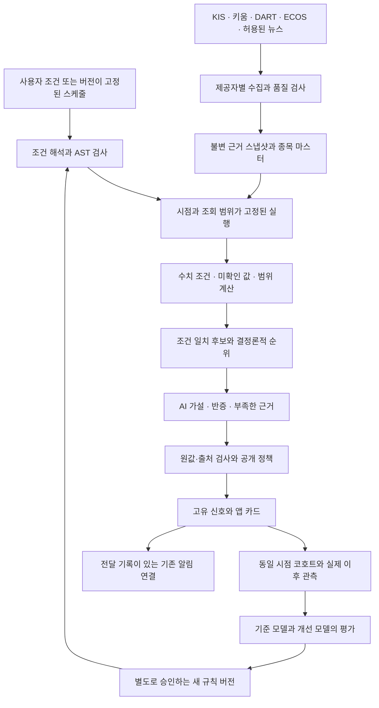

# BitMan: 검증 가능한 AI 주식 조건검색 플랫폼 재설계

작성: 2026-10-12 KST · 기준 코드: `ec40975` · 상태: 사용자 검토용 설계

이 문서는 새 분석 시스템의 설계다. 여기 적힌 신규 구조·API·성능 목표가 현재 앱에 구현되거나 배포되었다는 뜻은 아니다. 기존 운영 앱과 공개 데이터 평가를 출발점으로 삼되, 데이터·검색·판단·성과의 계약부터 다시 정의한다.

## 1. 만들고 싶은 결과

사용자가 원하는 결과는 실제 데이터로 조건에 맞는 한국 주식을 찾고, 선정 이유와 탈락 이유를 이해하며, 그 조건이 이후에도 유효했는지 확인할 수 있는 서비스다. 분석력은 다음 네 항목으로 따로 측정한다.

1. **검색 정확성**: 사용자가 말한 조건을 정확히 계산했는가. 조사한 범위와 미확인 값은 무엇인가.
2. **근거 정확성**: 종목·시각·단위·기간·공시 버전이 실제 원자료와 일치하는가.
3. **경제적 유용성**: 사전에 정한 보유 기간에서 비용을 반영한 결과가 같은 시점의 비교 대상보다 나은가.
4. **운영 신뢰성**: 제한된 호출·시간·비용 안에서 완료하고, 장애 뒤 필요한 단계부터 복구하는가.

에이전트 응답 개수, 문장 길이, 합의율, 테스트 개수는 이 네 항목을 대신하지 않는다. 수익 확률은 충분한 동일 정의의 표본과 별도 확률 보정이 있을 때만 제공한다.

### 사용자 요구와 설계 가정

- 확인된 요구: 분석력 우선, 실제 데이터, KIS 주력과 키움 REST 보조 병행, 무료·저비용 우선, 지속적인 안정 운영, 앱에서 검출한 종목 품질 평가.
- 설계 가정: 첫 대상은 국내 주식이며 기존 단타·스윙·주도주·테마주·종가 화면과 구독 흐름은 호환한다. 자동 주문은 포함하지 않는다.
- 첫 실증은 종가 이후 결정되는 조건의 다음 거래일/5거래일 평가다. 장중 단타는 별도의 시세·세션·거래 가능 가격 자료를 확보해 검증한다.
- 기존 키움 MOCK 서버의 조회 값은 공급자가 반환한 관측값으로 사용하되 환경을 표시한다. 모의 주문·잔고·체결 기록을 실제 시장 성과로 사용하지 않는다.
- 제공자 약관·유료 앱 재배포·보관 권한은 별도 조건이다. API 접속 성공만으로 권한을 충족했다고 처리하지 않는다.

## 2. 실제 앱에서 확인한 출발점

직전 품질 평가의 공개 자료를 다시 계산하면 네 AI 모드 9개 슬롯은 4개 종목이며, 팬오션·HMM이 7개 슬롯을 차지한다. 목표와 손절의 표시 가격 거리 비율이 1보다 작은 항목은 4개다. 이는 선택의 중복·가격 계획의 검토 필요성을 보여주며, 기대수익이나 실제 손익을 증명하지 않는다.

- 재계산: `node docs/evaluate-detected-stock-quality.mjs` → `slots=9`, `distinctStocks=4`, `rewardRiskBelowOne=4`.
- 기존 30일 성적표는 보유 기간과 기준가 정의가 혼합되어 신규 구조의 성과 증거로 재사용할 수 없다.
- 새 완료 5거래일 성과는 직전 확인 시 0건이었다. 개선한 소프트웨어와 입증된 수익 성과는 분리한다.
- `ConditionRunService`는 최대 500개 실행과 실행당 200개 이벤트를 메모리에 보관한다. `AsyncJobManager`도 메모리와 30분 TTL을 사용한다. 재시작 후 복구·단계 재사용의 영속 계약이 없다.
- 현재 조건 카탈로그는 설명 문장과 데이터 출처를 담지만, 실행 가능한 수치 조건의 정식 문법·단위·정렬 의미를 충분히 고정하지 못한다.
- 키워드 검색은 제한된 후보에 추가 PER/수급 등을 조회한다. 이 상태에서 결과는 확인한 부분집합이며, 조건에 맞는 전체 시장 상위 순위를 의미하지 않는다.
- 기존 `EvidenceClaimGuard`, DART 전체 재무, 완료 일봉 계산, 출처 표시, 제한 큐, 거래일 성과 추적은 재사용 가치가 있다. 이들 기능이 곧바로 완전한 시점 재현 시스템을 뜻하지는 않는다.

공개 근거: [직전 연구·검증 기록](../../ANALYSIS_STRENGTHENING_RND_2026_10_12.md), [품질 계산](../../DETECTED_STOCK_QUALITY_CALCULATIONS_2026_10_12.json), [원 스냅샷](../../DETECTED_STOCK_QUALITY_SNAPSHOT_2026_10_12.json).

## 3. 비교한 세 가지 구조

| 방식 | 장점 | 부담·한계 | 판단 |
|---|---|---|---|
| **모듈을 나눈 단일 앱 + 영속 실행 기록 + 별도 연구 도구** | MiniPC에서 시작 가능. 동일 데이터·조건·평가 정의를 공유. 기존 인증과 배포 활용 | 경계와 영속 상태를 명확히 구현해야 함 | 첫 구조로 채택 |
| 데이터·검색·AI·성과별 서비스 + 메시지 브로커/Temporal | 여러 서버·작업자 확장, 장애 복구 도구 풍부 | 서비스와 저장소가 늘고 관측·배포 부담 증가 | 실제 동시 작업·규모가 필요해질 때 검토 |
| LLM 중심 자율 에이전트 군집 | 개방형 질문과 심층 조사에 유연 | 호출량·지연·동일성·중단·평가 통제가 어렵고 결과가 비결정적 | 관리자의 제한된 연구 작업에 사용 |

처음부터 만든다면 Java 21/Spring API, React 화면, 분석 전용 SQL 저장소, 파일 기반 근거 저장소, 격리된 연구 도구로 시작한다. 핵심 알고리즘은 Spring·LLM·네트워크에 의존하지 않는 순수 모듈이다. 분석 저장소는 회원·구독 저장소와 분리하고 기존 회원 DB를 마이그레이션하지 않는다.

운영 초기에는 분석 전용 H2와 단일 작업자가 충분한지 부하·재시작 검증으로 판단한다. 다중 작업자가 필요하면 PostgreSQL로 옮기며, SQL 방언·잠금 방식은 별도 적합성 검사 대상이다. `SKIP LOCKED`는 작업 큐 소유권에 사용할 수 있지만 분석용 시장 스냅샷 조회에는 사용하지 않는다. [PostgreSQL 잠금 문서](https://www.postgresql.org/docs/current/sql-select.html)

Temporal의 이벤트 이력·재시작 재생은 확장 대안이다. 그것을 쓰더라도 외부 공급자의 과금·Telegram 전달 멱등성이 자동으로 생기지는 않는다. [Temporal Event History](https://docs.temporal.io/encyclopedia/event-history), [Activity Definition](https://docs.temporal.io/activity-definition)

## 4. 전체 데이터 흐름



모든 화살표에는 입력 버전·내용 해시·처리 상태가 있다. 수집 요청 시각과 자료 기준 시점, 수집 종료/스냅샷 고정 시각을 구분한다. `decisionCutoff`는 수집을 닫고 스냅샷을 고정할 때 확정하며 이후 변경하지 않는다. 순환 조회 자료는 종목별 관측 시각 차이를 포함하므로 동일 순간의 전 시장 관측이라고 표현하지 않는다. 공개되는 신호가 사용하는 근거는 공개 전에 영속 저장을 확인한다. 근거 저장에 실패한 새 후보가 기존 검증 결과를 덮어쓰지 못한다.

## 5. 데이터의 첫 번째 계약: 당시 무엇을 알 수 있었는가

### Observation

| 필드 | 의미 |
|---|---|
| `observationId`, `contentHash`, `schemaVersion` | 동일 자료 식별 및 무결성 |
| `instrumentId`, `ticker`, `issuerId`, `instrumentType` | 날짜에 따라 바뀔 수 있는 종목·발행사 관계 |
| `provider`, `providerEnvironment`, `venue`, `session` | KIS/키움 등, REAL/MOCK, 거래소·세션 |
| `eventTime`, `periodStart`, `periodEnd`, `timeBasis` | 체결·보고·관측 자료의 실제 적용 시점과 기간 |
| `publishedAt`, `firstObservedAt`, `availableAt`, `ingestedAt` | 원천 공표, 시스템 최초 관측, 사용 가능 시점, 저장 시각을 구분 |
| `metric`, `value`, `unit`, `currency`, `adjustmentBasis` | 원값·원/주/배·원화·가격 수정 방식 |
| `status`, `missingReason`, `revisionOf`, `qualityFlags` | 완료/부분/미확인/충돌·정정 관계 |
| `sourceRef`, `rawArtifactRef`, `retentionPolicyId` | 비밀을 제거한 원천 식별, 허용된 보관물 참조 |

- 실제 원천의 공표 시각을 모르면 `publishedAt=null`이다. 일자·접수번호를 시각으로 변환해 정밀도를 만들어내지 않는다.
- 라이브 판단에서 `availableAt`은 실제 시스템이 사용할 수 있었던 시점으로 기록한다. 소급 반입 자료는 과거 시스템 최초 관측을 주장하지 않는다.
- 같은 공시의 정정 전·후 내용을 둘 다 보존하고 당시 사용 가능한 버전을 선택한다.
- 가격 수정은 raw/adjusted/total-return을 나눈다. 배당·분할의 후행 수정 정보가 과거 특징값에 섞이지 않게 한다.
- KIS와 키움 값은 각각 보관한다. 같은 종목이라도 시각·세션·단위·수정 방식이 다르면 단순 평균으로 합치지 않는다.
- 같은 거래소 원천을 재유통하는 두 공급자의 일치는 관측 대조다. 서로 독립된 기업 정보 두 건으로 계산하지 않는다.
- 데이터 보관 권한이 없어 원자료를 저장하지 못하면 `replayability=INSUFFICIENT`로 표시한다. 해시만으로 나중에 내용을 복원할 수 있다고 주장하지 않는다.

### 종목 마스터와 시장 범위

현재 상장 종목을 과거 전체 기간에 적용하지 않는다. 마스터에는 상장·폐지·거래정지·상품 유형·종목코드 변경의 유효 기간과 출처를 둔다. 코드 끝자리나 최신 이름 문자열로 보통주·ETF·우선주를 확정하지 않는다.

매 실행의 `UniverseSnapshot`은 구성 종목 목록, 기준 시각, 취득 경로, 전체/부분 여부, 누락 사유를 고정한다. 전체 종목 목록이 없으면 `universeTotal=null`이고 조사한 수만 표시한다. 조회한 400개나 후보 600개를 전체 시장이라고 부르지 않는다.

venue·세션·거래일 캘린더도 버전 대상이다. KRX 정규장 정책과 다른 시장·애프터마켓을 분리한다. 15:30 이후라는 이유만으로 모든 거래·관측이 종료되었다고 판단하지 않는다.

## 6. 조건검색: 자연어를 실행 가능한 계약으로 바꾸기

### 단계

1. 이름·종목코드 검색과 수치 조건 검색을 구분한다.
2. 정해진 문법은 결정론 파서가 해석한다. 복잡한 자연어는 AI가 제한된 AST 후보만 제안한다.
3. 서버가 지표·단위·연산·기간·시장·정렬 의미를 검사한다.
4. 화면에 짧은 해석을 표시한다. 모호한 필수 항목만 한 번 확인하며 매 검색에 승인 단계를 강제하지 않는다.
5. AST를 버전과 해시로 고정하고 원문 대신 이 실행 정의를 재사용한다.

예: “상승률 상위 20 PER 100 이하”에는 두 의미가 있다.

- `FILTER_THEN_RANK`: PER 조건을 통과한 종목 중 상승률 순 20개.
- `RANK_THEN_FILTER`: 상승률 순 20개를 먼저 선택하고 그 안에서 PER 조건을 만족하는 종목.

기본값은 첫 의미로 정하고 화면에 “PER 100배 이하에서 상승률 순 20개”라고 표시한다. 순서를 바꾸는 선택도 제공한다. 자료 부족 때문에 두 번째 방식으로 실행한 뒤 첫 번째로 표시할 수 없다.

### 설계 예시 AST

```json
{
  "schemaVersion": "condition-ast-v1",
  "universePolicy": "KR_COMMON_EQUITY",
  "sessionPolicy": "PRIMARY_KRX_REGULAR",
  "selectionOrder": "FILTER_THEN_RANK",
  "where": {
    "all": [{"metric": "valuation_per", "op": "lte", "value": "100", "unit": "MULTIPLE", "basis": "PROVIDER_DEFINED"}]
  },
  "rank": {"metric": "session_change_pct", "direction": "DESC", "tieBreak": "instrumentId"},
  "limit": 20,
  "unknownPolicy": "REPORT_SEPARATELY"
}
```

예시는 문법 설계다. 공급자의 단순 PER 필드만 있을 때는 공급자 정의와 기간 미확인을 명시하고 TTM 지표로 바꾸지 않는다. 적자·분모 0·누락을 구분하며 단순히 음수 PER가 100 이하라는 이유로 저평가 조건을 통과시키지 않는다. 공급자·기간 정의가 확인된 TTM 지표는 별도 metric이다.

### 세 가지 판정

각 조건은 `TRUE / FALSE / UNKNOWN`을 반환한다. 미확인 값을 0이나 false로 바꾸지 않는다. AND/OR/NOT도 같은 논리를 사용한다. 조건 판정과 공개 자격은 따로 검사한다. OR의 한 조건이 참이어도 종목 식별이나 시세가 필수 기준을 못 채우면 공개할 수 없다.

검색 결과에는 다음을 함께 제공한다.

- 조사 대상 수, 완료 수, 참·거짓·미확인 수, 아직 조사하지 않은 수.
- 실제 사용한 자료의 기간·시각 및 지표별 누락 사유.
- `rankingScope=COMPLETE / TOP_K_PROVEN / KNOWN_SUBSET`.
- 동일 종목의 모드별 포착 이유와 한 번만 센 고유 후보 수.

### 호출 제한 안에서 더 많이 찾는 방법

싼 조건·기존 캐시로 전체 취득 범위를 먼저 거르고, 비싼 지표는 필요한 후보에만 조회한다. 순위 기준이 모두 알려져 있으면 순위 순서로 필터를 조사해 K개를 찾을 수 있다. 다만 더 높은 순위의 UNKNOWN이 남거나 아직 조회하지 않은 대상이 순위를 바꿀 수 있으면 `TOP_K_PROVEN`을 부여하지 않는다. 자료가 허용될 때만 하한·상한으로 조기 종료를 증명한다.

장중 수요, 야간 증분 보강, 사용자 관심 종목을 전역 제공자 예산 아래 나눈다. 마지막 조사 위치를 보존하고 공정하게 순환한다. 코드순으로 잘라 낮은 코드 종목만 반복 조사하지 않는다. 동일 제공자·TR·종목·기간은 single-flight로 요청을 합친다.

## 7. 분석 엔진: 조건·순위·근거·가설을 분리

| 층 | 산출물 | 공개 의미 |
|---|---|---|
| 자격 | 상품 유형·거래 상태·유동성·필수 자료 유무 | 실제 조사 가능한 대상 |
| 조건 | 참/거짓/미확인과 각 계산 근거 | 요청한 수치 조건 충족 여부 |
| 순위 | 버전이 고정된 특징값·정렬·동률 해소 | 해당 범위 내 순서 |
| 근거 품질 | 시각·기간·원자료 연결·충돌·누락 | 분석에 사용한 자료의 신뢰 범위 |
| AI 가설 | 지지 근거·반증·추가 확인·무효화 조건 | 수치 자료를 해석하는 검토 의견 |
| 이후 평가 | 동일 정의의 미래 관측·비용·비교 대상 | 실제로 측정된 과거 결과 |

지표를 많이 추가할수록 우수한 조건이 되는 것은 아니다. 첫 연구 조건은 단순한 기준 모델과 비교할 수 있게 소수로 고정한다.

- **스윙**: 같은 완료 거래일의 추세·시장 대비 강도·눌림 폭·변동성. 상승 종목 추격과 추세 눌림을 별도 조건으로 비교.
- **주도주**: 거래대금 지속성, 같은 기간의 외인/기관 수급, 같은 거래일의 업종 대비 강도. 단일 급등일의 순위와 구분.
- **테마/이벤트**: 실제 공시 또는 허용된 뉴스의 신규성, 발행사 관계, 정정·철회·악재, 사건 이후 가격 반응. 제목 키워드만으로 호재 점수 생성 금지.
- **단타·종가**: 관측 시점에 이용 가능한 장중 값과 다음 실제 거래 가능 가격. 장중 자료 없이 일봉으로 체결 시점이나 지속성을 추정하지 않음.

이 목록은 연구 가설이며 검증된 초과수익 전략이 아니다. 매수/손절/목표 표시는 규칙이 고정된 가격 시나리오와 가정으로 계산한다. AI가 임의로 정한 숫자를 기대수익으로 표시하지 않는다. ATR 등의 배수도 탐색값이며 장중 호가·가격제한·갭·기업행동을 반영한 검증을 통과해야 한다.

모드 간 중복은 하나의 종목 카드 안에 여러 조건 배지로 보여준다. 섹터·기업·공통 사건 집중도도 따로 표시한다. 다양성 규칙이 순위를 바꾸면 원 순위와 제외 이유를 보존하고 그 정책 버전도 평가한다.

## 8. AI 에이전트를 어디에 쓰는가

실제 종목과 수치의 출처는 도구다. AI는 검증된 후보에 대한 가설·반증·불확실성을 구조화한다.

| 역할 | 입력 | 출력 | 실행 방식 |
|---|---|---|---|
| 조건 해석 | 사용자 문장과 허용 지표 목록 | AST 후보·모호한 항목 | 정형 문법은 파서, 필요 시 저비용 모델 |
| 사건 추출 | 허용된 발췌문·기업 식별자·공표 시각 | 사건 유형·기업 관계·주장 근거 | 새로운 사건만 처리·중복 재사용 |
| 분석가 | 고정된 후보·동일 시점 EvidenceBundle | 가설·factId·무효화 조건 | 소수 후보에 제한 호출 |
| 반증 검토자 | 원 근거와 별도 누락/악재 검색 결과 | 반대 근거·충돌·판단 유보 | 가설을 읽기 전 원 근거부터 검토하는 순서 비교 |
| 설명자 | 서버가 승인한 사실·판정·제약 | 짧은 한국어 설명 | 템플릿 우선, 필요 시 제한 모델 |
| 연구 감독 | 격리된 평가 보고서·실험 목록 | 새로운 실험 제안 | 최고 성능 모델을 어려운 연구에 집중 |

`Hypothesis` 계약에는 `candidateId`, `bundleHash`, `hypothesisType`, `supportingFactIds`, `contradictingFactIds`, `unknownRequirements`, `invalidationRuleIds`, `abstentionReason`을 둔다. 모델의 숫자·출처·종목·기간을 서버 원값과 대조한다. JSON Schema 형식 통과와 사실 정확성 검사는 별개의 단계다. factId의 같은 후보·bundle 소속, 가설별 필수 근거·방향·기간, 원문 인용의 관계 적합성도 검사한다. 올바른 숫자를 인용했다는 사실만으로 가설의 인과 관계나 의미적 지지를 승인하지 않는다.

자료 부족은 판단 유보다. 필수 데이터가 부족하면 AI를 호출하지 않는다. AI 단계만 실패하면 수치 조건 결과는 남고 “AI 검토 미완료”로 표시한다. 반증이 실제 수치 조건을 바꾸려면 승인된 지표·규칙이 있어야 하며 자유 서술로 검색식을 수정할 수 없다.

도구 호출은 앱이 관리한다. 허용된 읽기 전용 도구, 종목·날짜 범위, 반환 바이트, 호출·토큰·시간 예산을 검사한다. 기사·공시 본문에 포함된 명령은 자료로 취급하며 실행 권한이 되지 않는다. 주문·비밀 읽기·임의 URL·코드 실행·회원 조회 도구는 분석 에이전트에 제공하지 않는다.

모델은 `extractor`, `analyst`, `critic`, `research_supervisor` 설정 프로필로 선택한다. 계정 가용성·한국 주식 품질을 검사한 실제 모델 ID와 버전을 실행에 기록한다. 최신 이름만으로 핵심 모델을 자동 교체하지 않는다. 모델 변경은 같은 입력·검사·예산으로 비교한다.

### 비용 계약

- 월/일/실행별 금액 한도와 동시 호출 한도는 앱에서 관리한다.
- 요청 전 최대 입력·출력/추론 사용량을 포함한 보수적 비용을 예약한다. 필요한 한도를 모르면 호출을 시작하지 않는다.
- 실제 usage와 과금은 별도로 기록한다. 응답을 못 받았거나 종료 여부가 불명확하면 `UNCERTAIN`이며 0원으로 적지 않는다. 원 비용 예약은 유지하고 응답 ID·실제 사용량을 대조하기 전 자동 환급·재호출을 하지 않는다.
- 응답 원본을 저장한 뒤 검사한다. `REFUSED`, `INCOMPLETE`, `OUTPUT_LIMIT`, `FAILED`, `INVALID_SCHEMA`를 구분한다. 완료 응답이며 refusal이 없고 의미 검사를 통과한 것만 `VALIDATED`로 전이한다. 한 번의 JSON 교정은 완료 응답의 허용된 형식 오류에만 적용하며 거부·잘린 응답·불명확한 완료를 정상화하는 수단으로 사용하지 않는다.
- 뉴스 발췌·모델·프롬프트·스키마·입력 해시가 같을 때 완료 단계를 재사용한다. 가격이 달라지면 의존하는 이후 단계만 무효화한다.
- OpenAI 공식 기능·모델·요금 연구는 [AI 연구 노트](../../research/2026-10-12-redesign-agents.md)에 기록한다. 요금표의 계산 예시는 한국 주식 분석 품질의 증거가 아니다.

## 9. 안정 운영: 실행과 게시의 영속 계약

### 상태와 저장

실행은 `QUEUED → COLLECTING → SNAPSHOT_READY → FILTERED → REVIEWED → VALIDATED → PUBLISHED`를 사용한다. 단계별 `RECEIVED`, `FAILED`, `CANCELLED`, `EXPIRED`, `UNCERTAIN`, `SKIPPED`도 기록한다. 후보 수가 0개인 성공, 필수 자료 없음, AI 실패는 서로 다른 상태다.

| 기록 | 주요 식별과 불변 조건 |
|---|---|
| `AnalysisRun` | ownerScope·runId·strategyVersion·ASTHash·universeHash·decisionCutoff·revision |
| `StageAttempt` | runId·stage·attempt·dependencyHashes·inputHash·outputHash·status·leaseGeneration |
| `EvidenceBundle` | bundleHash·observationIds·featureCalculatorVersion·coverage·replayability |
| `Signal` | signalId·instrumentId·publishedAt·strategyVersion·bundleHash·rankPolicyVersion |
| `Outcome` | signalId·horizon·evaluationPolicyVersion·observationRefs·measurementState |
| `ProviderBudget` | credentialScopeHash·environment·TR·window·reserved/used·cooldown |
| `DeliveryOutbox` | signalRevision·channel·destinationScopeHash·deliveryState·providerReceipt |

동일 조건의 비교 단위는 **같은 대상·시점·입력 버전**으로 고정한다. 실행 정의는 변경하지 않고 단계 재시도는 별도 attempt로 구분한다. 저장한 성공 출력을 재사용할 때도 의존 입력이 모두 같아야 한다.

### 복구·동시성·취소

- 실행 생성은 owner scope와 입력 지문에 묶인 멱등 키를 사용한다. 다른 사용자의 결과를 노출하지 않는다.
- 작업자는 제한된 lease를 받고, 갱신한 generation만 결과를 저장할 수 있다. 옛 작업자의 늦은 응답은 현재 결과를 덮어쓰지 못한다.
- 재시작 시 미완료 단계만 복구한다. 실제 외부 요청 완료 여부가 불명확하면 요청 ID 대조 또는 판단 유보로 남긴다.
- 취소는 durable 상태를 먼저 갱신하고 진행 중 연결·공급자 요청의 중단을 요청한다. 중단 요청·확인·미확인을 기록하고 공급자의 즉시 실행 중단이나 과금 중단을 보장하지 않는다. 중단 확인 전에는 비용 예약을 유지한다. 게시 트랜잭션에서 run revision·leaseGeneration·미취소 상태를 다시 검사한다. 취소 후 도착한 응답은 후보 보존만 가능하며 게시·알림을 실행하지 않는다.
- 새 검증 결과와 공개 포인터·outbox 생성은 한 트랜잭션으로 묶는다. 마지막 정상 결과는 삭제하지 않고 시각·유효 범위를 표시한다.
- 401/403은 자동 재시도하지 않는다. 429는 공식 한도·Retry-After·전체 예산 내에서 대기한다. 일시적 오류도 제한된 횟수만 재시도한다.
- Telegram은 요청 성공 여부가 불명확할 수 있다. outbox가 있어도 공급자 멱등 기능이 없다면 정확히 한 번 전달을 보장하지 않는다. 불명확 건의 자동 재전송과 새 전체 발송은 구분한다.

### 공급자 예산

KIS·키움 각각의 공식·계정 한도에 맞춘 전역 예산을 둔다. 모의/실전·TR별 추가 제한, 페이지 조회, 토큰 발급, WebSocket 세션도 관리한다. API별 제한을 독립 스레드마다 적용해 합산 초과하는 구조는 허용하지 않는다.

키움 현재 공식 한도와 조건검색 WebSocket 소유권, KIS 공식 후보 소스는 [데이터 연구 노트](../../research/2026-10-12-redesign-data.md)에 기록한다. 부하 시 사용자 요청·필수 갱신의 예약 몫을 남기고 야간 작업을 늦춘다. 가격·이벤트·재무의 다른 갱신 주기를 사용해 동일 자료를 반복 조회하지 않는다.

상태 조회는 저장 기록만 읽는다. 시스템 화면의 폴링이 시장 조회나 유료 모델 호출을 시작할 수 없다.

### 운영 목표: 구현 후 측정할 값

한 MiniPC에서 시작하는 목표이며 현재 달성했다는 의미가 아니다.

- 캐시 결과 조회 p95 2초 이내, 실행 상태 조회 p95 300ms 이내.
- 첫 연구 실행 30초 벽시계 예산. 예산 종료 시 실제 부분 범위와 미완료 단계 표시.
- 제공자 한도 초과, 취소 후 게시, 다른 사용자 결과 접근, 미래 자료 누출은 장애 주입 검사에서 0건.
- 같은 입력 실행의 재시작 복구에서 검증 완료 단계의 추가 제공자 호출 0회. 시점이나 자료 유효성이 달라지면 새 실행으로 구분.
- 디스크·큐·응답 크기·동시 실행에 각각 상한. 연구 이력과 공개 신호 보관 기간은 라이선스와 디스크 측정으로 따로 설정.
- 주기적인 백업 복원 검사. health 200·작업 실행 상태와 실제 데이터 최신성·종목 품질 지표를 함께 확인.

## 10. 성과 평가를 제품의 일부로 설계

### 관측 평가와 가격 시뮬레이션

1. **관측 평가**: 실제 공개 시점과 유효한 기준가격, 이후 1/3/5/20 거래일의 실제 관측 변화. `firstVisibleAt`, `referenceObservedAt`, 가격 유효성 정책을 분리한다. 이전 시각의 저장 시세부터 이미 발생한 상승분을 공개 이후 성과로 포함하지 않는다. 공개 시점 기준을 확인할 수 없으면 명시한 가격 관측 구간만 보여주거나 미측정으로 남긴다.
2. **거래 시뮬레이션**: 사전 고정한 진입/청산·거래 가능 세션·가격·갭·수수료·세금·슬리피지·유동성 가정으로 계산. 실제 주문 수익이라고 표시하지 않는다.

일봉만 있는 첫 연구에서는 완료된 신호의 다음 KRX 정규 거래 세션 시가를 가상 진입 참조가격으로 삼는다. 진입 세션을 1로 세어 1일은 그 세션 종가, 3/5/20일은 세 번째/다섯 번째/스무 번째 세션 종가다. 첫 정책의 진입 유효기간은 그 다음 정규 세션 하나로 제한하며 한참 뒤 거래 재개 가격으로 자동 이동하지 않는다. 시가 관측만으로 원하는 금액의 실제 체결을 확인했다고 주장하지 않는다. 데이터가 없거나 거래정지/가격제한으로 거래 가능성이 확인되지 않으면 `UNMEASURABLE` 또는 `UNFILLABLE`이다. 다른 날짜 가격을 채워 넣지 않는다.

고가·저가가 같은 봉에서 목표와 손절을 모두 지나면 도달 순서는 모른다. `AMBIGUOUS_PATH`를 남기고 사전에 정한 보수적 시나리오와 구간을 따로 제시한다. 고가를 모두 실현 수익으로 계산하지 않는다.

신호의 관측 결과와 사용자의 실제 거래는 다른 기록이다. 회원 거래내역을 가져오거나 주문 기능을 만들지 않는다.

### 실험 순서

- B0: 유동성 자격과 단순 순위만 적용한 기준 모델.
- B1: 완료 일봉·시장 대비 강도를 추가한 수치 조건.
- B2: 같은 시점 DART/수급 근거를 추가한 수치 조건.
- B3a: 같은 후보·AST·순위를 유지하고 AI 가설·반증 설명을 추가. 설명의 근거 정확성과 운영 효과만 평가.
- B3b: 사전 등록한 정책에 따라 AI의 구조화 검토가 공개 기권을 바꾸는 비교. AST와 원 수치 순위는 유지하고 기권 사유·필수 fact를 기록. 자유 서술은 검색식을 수정하지 않으며, 순위 변경이 필요하면 별도 정책·실험 버전으로 등록.
- B4: 집중도 제한·공개 정책 변경.

한 번에 여러 층을 바꾼 성과를 AI의 효과로 부르지 않는다. 같은 날짜·범위·체결·비용 정책에서 한 요소씩 제거하는 비교를 수행한다. 경제적 효용이 없더라도 설명 사실성·불필요 호출 감소의 효과는 따로 기록할 수 있다.

훈련·탐색·검증은 시간순으로 나누고 목표 보유 기간에 따라 겹치는 라벨을 제거한다. 보통 `TimeSeriesSplit`의 gap만 설정하는 것으로 모든 불규칙 시점·중첩 종목 라벨 누출이 해결되지는 않는다. 후보 조건·임계값·실험 횟수를 등록하고 보류 표본을 반복 최적화에 쓰지 않는다.

현대 LLM으로 과거 기사를 분석하면 학습 지식에 미래 결과가 들어 있을 수 있다. “당시 기사만 입력했다”는 사실만으로 과거 예측의 완전한 시점 준수를 증명할 수 없다. 과거 AI 재생은 형식·근거 검사 연구로 제한하고 수익 개선의 핵심 증거는 앞으로 모으는 shadow 코호트로 확인한다.

평가 지표: 완결률·근거 오류·UNKNOWN 비율·조사 범위, 일별 바스켓 비용 후 수익·비교 대상 대비 차이·하락 위험·회전율·집중도, 추천 일수·고유 종목 수·독립적인 날짜 표본·미측정/거래 불가 비율, 실행 지연·비용·재사용률. 비용 미확인은 gross만 계산하고 net은 null이다. 비교 대상의 날짜·세션·가격수익/총수익 기준이 맞지 않거나 자료가 없으면 excess는 null이다. 미측정은 0이 아니다.

“100건이면 충분하다” 같은 공통 합격선을 두지 않는다. 먼저 효과 크기·분산·중복 라벨을 이용해 표본 필요량을 추정한다. 완료 추천 슬롯 수와 독립된 거래일 수를 함께 제공한다. 검증력이 부족하면 결과는 `INSUFFICIENT_EVIDENCE`다.

자세한 캘린더·체결·기업행동·중첩 표본·통계 계약은 [평가 연구 노트](../../research/2026-10-12-redesign-evaluation.md)에 둔다.

## 11. 사용자 화면과 운영 워크플로우

### 홈과 검색

- 첫 화면은 고유 종목 카드, 충족 조건, 관측 시각, 조사 범위, 주요 반증을 보여준다.
- 동일 종목이 단타·주도주 등에 나타나면 카드 하나에 모드 배지를 붙인다. 모드별 필터는 유지한다.
- 검색하면 해석한 조건과 현재 확인 결과가 먼저 나온다. 화면의 논리적 검색 세션은 유지하되, 고정 cutoff 뒤 처음 수집한 자료는 새 run/snapshotRevision/decisionCutoff/bundleHash를 만든다. 이전 결과를 보존하고 최신 revision으로 연결한다. 고정 시점에 이미 이용 가능했던 같은 스냅샷 자료를 처리하는 진행률만 동일 run 안에서 갱신할 수 있다. 늦게 받은 새 자료로 과거의 부분 결과를 완전 순위나 과거 시점의 성과로 소급 승격하지 않는다.
- 자료 부족 항목은 별도 “추가 확인” 목록이다. 가상 종목이나 확인되지 않은 가격으로 빈칸을 채우지 않는다.
- 상세 화면은 조건별 계산 근거 → 출처와 기간 → AI 가설/반증 → 무효화 조건 → 같은 정의의 이후 결과 순서다.
- “근거 확인”, “자료 일부”, “AI 검토 완료”는 각각 다른 표시다. 숫자 합의율을 수익 가능성으로 표기하지 않는다.

### 성과 화면

사용자는 조건 버전·보유 기간·기준가격·비용 정책을 선택한다. 완료 표본/대기/미측정 수와 비교 대상을 보여준다. 관측 수익과 체결 시뮬레이션은 다른 탭이다. 구버전 성과는 당시 정의가 보존된 별도 이력이다.

### 관리자

재실행 버튼은 실패한 단계와 예상 호출·비용을 보여준다. 소스별 최신성·UNKNOWN·범위·교차 조회 진행률, 모델별 오류·비용불명·사실 거부, 실행 lease·큐 깊이·현재 build를 점검한다. 새 규칙은 버전과 평가 보고서 없이 운영 기본값으로 바꾸지 않는다.

### 기존 알림

같은 신호 식별자·공개 수정번호를 앱과 Telegram이 공유한다. 새 사실·무효화·유효한 새 포착처럼 정의한 변화만 알린다. 스케줄 시간·권한·기존 구독자 범위는 운영 설정으로 연결하고 연구 실행은 알림 전송을 시작하지 않는다.

## 12. 첫 연구개발 범위와 후속 전환

대규모 구조 전체를 한 번에 구현하는 대신, 각각 검증 가능한 세 작업으로 분리한다.

### A. 연구 핵심: 조건·근거·재현 계약

첫 구현 대상은 네트워크·LLM·회원 DB와 분리된 실행 가능한 연구 모듈이다.

- 버전이 고정된 Observation/Universe/AST/EvaluationPolicy 입력.
- 승인 지표·단위 검사, TRUE/FALSE/UNKNOWN, FILTER_THEN_RANK 의미.
- 실제 공개 스냅샷 입력의 데이터 부족·오래된 시세·중복 결과. 없는 지표를 생성하지 않음.
- 결정론적 결과 해시, 입력 변경 시 재사용 무효화, 저장 완료 단계 재개.
- 관측 결과와 시뮬레이션의 분리, 겹친 목표/손절·미측정 결과 처리.
- 독립 코드 리뷰와 작은 대표 입력의 끝까지 실행한 보고서.

현재 공개 픽 스냅샷에는 미래 시가·종가가 없다. A의 실제 입력 결과에서 미래 성과는 미측정이며 신규 수익률·승률을 산출하지 않는다. 경로·기업행동·체결 등의 예외 검사는 합성 fixture임을 표시하고 실제 종목 성과와 분리한다. AI 연결 경계도 가짜 응답으로 검사하며 외부 모델 품질 실증과 구분한다.

제품 API·생산 스케줄·회원 DB·실제 알림에는 첫 연구 모듈을 자동 연결하지 않는다. 연구 모듈을 성공적으로 실행한 것과 수익 개선은 별도의 증거다.

### B. 병행 실증: 제공자·실행 저장·성과 수집

기존 어댑터를 새 계약에 맞춰 연결하고, 별도 분석 저장소에 공개 후보와 실제 이후 관측을 보존한다. 기존 결과와 동일 시점에 비교하는 shadow 실행을 사용한다. 호출·비용 예산을 실제 측정하고 부분 검색을 정직하게 표시한다. 필수 제공자 권한과 저장 범위가 충족되어야 운영 연결이 가능하다.

### C. 제품 전환: UI·관리자·알림

기능 플래그와 기존 API 변환기를 두고 조건식별로 전환한다. 기존 회원·구독과 URL을 유지한다. 배포는 로컬 테스트·버전 확인·백업·MiniPC·양 Pages·사용자 URL DOM 확인을 거친다. 신호 공개 포인터를 구버전으로 돌리는 롤백을 포함한다.

### 신설 API 계약의 방향

첫 A 단계에는 외부 API를 만들지 않는다. B/C 단계에서 추가 namespace를 사용한다.

- `POST /api/analysis/v2/runs`: 실행 정의/멱등 키 → 202/runId, 동기 유료 재호출 없음.
- `GET /api/analysis/v2/runs/{id}`: 소유자 검사, 저장된 상태/범위/결과.
- `POST /api/analysis/v2/runs/{id}/cancel`: durable 취소와 revision 검사.
- `POST /api/admin/analysis/v2/runs/{id}/resume`: 실패 단계와 제한 예산으로 재개.
- `GET /api/analysis/v2/signals/{id}`: 근거·버전·이후 관측.
- `GET /api/analysis/v2/performance`: 명시적 평가 정책과 코호트 조회.

기존 응답 타입을 소급 재해석하지 않는다. 새로운 확률·완료 상태·성과의 뜻은 새 계약과 화면으로 도입한다.

## 13. 설계 검토와 사용자 결정

이번 연구의 추천은 A → B → C 순서다. 실력의 증거는 전체 앱을 얼마나 빨리 갈아엎느냐가 아니라, 같은 입력에서 더 정확히 계산하고 새로운 결과가 실제로 나아졌는지를 측정하는 것이다.

검토할 핵심 범위는 **A의 격리 연구 모듈부터 구현하고, B의 실측 비교를 통과한 조건만 C로 전환**하는 방향이다. 이 설계를 승인하면 상세 실행 계획과 구현 방식을 확정한다.

사용자가 직접 확인해야 할 항목은 공급자의 유료 서비스 정보 이용·보관 범위와 새 유료 모델을 실제 운영에 쓸 때의 금액 한도다. 새 키를 채팅으로 받을 필요는 없다. 수집 가능한 사실과 오프라인 검증은 개발자가 처리한다.

## 14. 연구 근거와 자체 검토

- 공식 자료 확인일: 2026-10-12. API·모델·요금·세션 규칙은 운영 활성화 시 다시 확인한다.
- [데이터·검색 공식 연구](../../research/2026-10-12-redesign-data.md)
- [평가·성과 공식 연구](../../research/2026-10-12-redesign-evaluation.md)
- [OpenAI·에이전트 공식 연구](../../research/2026-10-12-redesign-agents.md)
- 이 문서에 제시한 상태·API·성능·구현 범위는 신규 설계이며 현재 배포 상태와 분리했다.
- 현재 코드 위치·공개 수치와 설계 가정을 구분했다. 실제 수익 개선을 주장하지 않았다.
- 자체·팀 검토에서 시각 정밀도, UNKNOWN 논리, 검색 순서, 범위 분모, 비용불명, 재시작 복구, 과거 LLM 지식 누출을 검토한다.
- 독립 팀 검토에서 제기한 10개 경계 문제를 보완했다: 불명확한 비용의 예약 유지, 미완성/거부 응답, 취소 확인과 게시 fencing, 의미적 근거 적합성, 세션 기준과 진입 유효기간, 공개 시각과 이전 시세, 비용/비교 대상 미확인, 미래 성과가 없는 A 입력, AI 설명과 공개 기권의 효과 분리, 고정 스냅샷 뒤 추가 자료의 새 revision.
- 문서 검증: 네 파일의 UTF-8·미완성 표시·코드 블록·로컬 참조와 세 JSON 예시를 검사했다. 공개 품질 계산은 9/4/4로 재현했다. 제품 코드 변경이 없으므로 backend/frontend 테스트를 이번 문서 작업에서 재실행하지 않았다. 신규 시제품·수익 실증·배포는 아직 수행하지 않았다.
